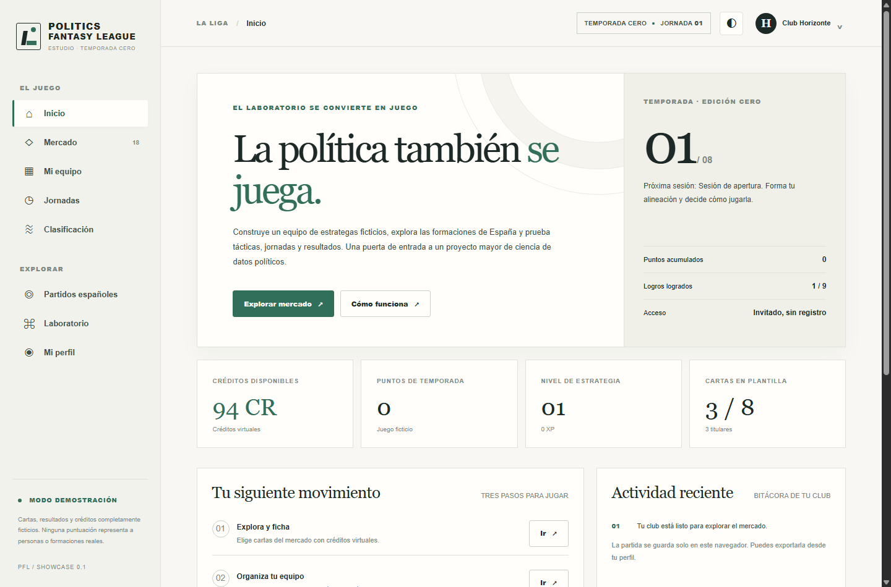
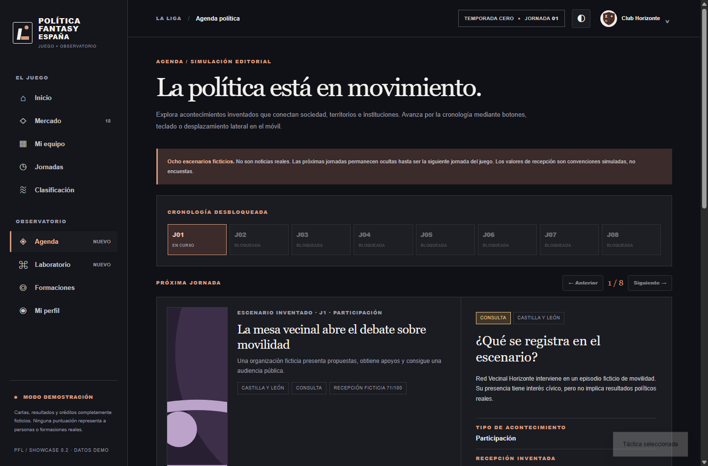

# Política Fantasy España — Showcase v0.3 (Politics Fantasy League)

**Prototipo de presentación, no lanzamiento público ni validación científica.** «Política Fantasy España» es un nombre visual provisional, no un cambio del repositorio. Esta interfaz editorial y lúdica es independiente del backend de PFL y abre sin registro, servidor ni dependencias.



*Captura de la propia interfaz ejecutada localmente en Chrome, no imagen conceptual ni representación de resultados políticos reales.*

## Abrir

**Acceso más fácil en Windows:** hacer doble clic en ABRIR_DEMO.cmd dentro de esta carpeta; abre index.html en el navegador predeterminado. El archivo HTML también puede abrirse directamente. Para compartirlo, comprime los ficheros de esta carpeta, **incluida artwork/**, en un ZIP (no contiene tu partida personal).

En Windows, abrir `product/showcase/index.html` con doble clic (Chrome, Edge o Firefox). Si se prefiere un servidor local:

```powershell
cd product/showcase
py -3 -m http.server 8765 --bind 127.0.0.1
# Abrir http://127.0.0.1:8765/
```

**No hay publicación web ni acceso remoto configurado.** La aplicación funciona con HTML/CSS/JS local y `localStorage` del navegador. El modo invitado utiliza un club ficticio preconfigurado; no recoge contraseñas, correos electrónicos ni datos personales.

## Funciones implementadas

- Inicio editorial responsive con guía de entrada inmediata, misiones y progreso de temporada.
- Mercado de 18 cartas de **roles/personajes enteramente ficticios** con precios, atributos declaradamente sintéticos, fichajes/ventas y filtros.
- Plantilla de hasta 8 cartas; hasta 5 titulares, elección de capitán y táctica. Acciones persistentes localmente.
- Simulación local determinista de jornadas, resultados explicables por carta/táctica, créditos, experiencia y clasificación **de clubes ficticios**.
- Catálogo amplio, exploratorio y NO exhaustivo de formaciones, coaliciones y agrupaciones españolas con búsqueda, filtros y favoritos cosméticos. **No es copia autenticada del Registro de Partidos Políticos** y no certifica su vigencia, inscripción, afiliación, representatividad ni cambios de denominación.
- Perfil editable (nombre del club, insignia), estadísticas, insignias por acciones realmente realizadas, contraste claro/oscuro y exportación/importación local para continuar en otro navegador.
- Laboratorio que diferencia mecanismos de reglas ficticias, cobertura documental conocida y ambiciones científicas todavía pendientes.

## Cambios en la v0.2

- Diseño oscuro grafito predeterminado y modo claro alternativo, cuatro paletas elegibles y logo provisional geométrico conservado.
- Taller de heráldica: escudo generado por geometría SVG a partir de 1–4 símbolos distintos y paleta elegida, persistentes localmente.
- Veintiséis ilustraciones SVG originales generadas de forma determinista con Python (18 personajes y ocho escenas de eventos). También hay una ilustración vectorial propia de hemiciclo en la portada.
- Bucle de juego más claro: dossier de un acontecimiento ficticio, plantilla, táctica, jornada, acta con contribución por evento y progreso.
- Observatorio/Laboratorio con seis vistas: Panorama, Territorios, Economía real, Políticas y sociedad, Fuentes oficiales y Motor fantasy. Los índices territoriales (19 unidades, cuatro indicadores, ocho periodos) son **simulados**, nunca datos reales de España.
- En Economía real se muestra una **instantánea manual fechada** del INE a 31/10/2026: IPC anual adelantado octubre 2026 4,9 %, tasa de paro EPA 3T 2026 10,18 %, ocupados 22.852.600, más una serie histórica de cambios de ocupación del segundo al tercer trimestre (2017–2026) según la misma nota oficial. Los valores están citados y separados de las simulaciones. **No existe canal de actualización automática ni se ingieren microdatos.**

Las diferencias entre las fuentes oficiales, las mediciones reales disponibles, los escenarios inventados y las aspiraciones de investigación se desarrollan en el contrato metodológico: docs/SHOWCASE_V02_PRODUCT_AND_DATA_CONTRACT_20261031.md.

## Incremento v0.3: interacción y anticipación



*La captura procede de la ejecución real en Chrome; muestra una pantalla de la simulación, no una noticia española ni una visualización de acontecimientos reales.*

- Nueva novena ruta **Agenda política** con carrusel accesible mediante botones, flechas de teclado y desplazamiento horizontal táctil en teléfonos. Las ocho escenas son ficticias y permanecen bloqueadas hasta la jornada correspondiente.
- Barra inferior fija en móvil con cinco acciones: Inicio, Agenda, Equipo, Jugar y Datos. Conservar la navegación superior permite seguir entrando en las restantes áreas.
- **Análisis de la próxima jornada**, disponible desde Agenda, Mi equipo y Jornadas. Presenta bonificaciones sintéticas por carta según el acontecimiento actual y afinidad de las tres tácticas. Cambiar táctica no celebra la jornada ni muestra el resultado final futuro.
- El análisis se obtiene mediante una función pura de motor, no altera puntos, plantilla ni historial. Los desgloses de eventos pueden confrontarse con el acta tras celebrar la jornada.
- La vista en móvil de 390 px no presenta desbordamiento de página en Inicio, Agenda ni Laboratorio territorial según el ensayo CDP. No constituye aún una prueba de accesibilidad integral ni ensayo en teléfono físico.

El contrato de producto v0.2 sigue siendo aplicable. La ampliación no añade noticias reales, ingestión automática, fuentes oficiales nuevas ni puntuaciones de políticos; la economía real continúa siendo una instantánea INE fechada y separada del juego.

## Procedencia y alcance

Las denominaciones del catálogo utilizan referencias documentales como la [composición inicial del Congreso en 2023](https://www.congreso.es/backoffice_doc/prensa/notas_prensa/99427_1692877250184.pdf) y los [resultados de las europeas 2024](https://results.elections.europa.eu/es/resultados-nacionales/espana/2024-2029/), junto a nombres editoriales no autenticados individualmente. El [Ministerio del Interior](https://sede.interior.gob.es/portal/sede/tramites) mantiene un Registro de Partidos Políticos que requiere un proceso registral aparte para acreditar identidades y estados. No se afirma exhaustividad ni vigencia a 2026.

Las cifras reales del apartado Economía proceden exclusivamente de las notas oficiales [INE · EPA 3T 2026](https://www.ine.es/dyngs/Prensa/es/EPA3T26.htm), publicada el 27/10/2026, e [INE · IPC adelantado octubre 2026](https://ine.es/dyngs/Prensa/es/adIPC1026.htm), publicada el 30/10/2026. No se trasladan al sistema de puntuación. Las referencias al tiempo real son objetivos de desarrollo, no capacidades de esta versión.

Ningún personaje del mercado es un político real. Sus atributos, rendimientos, los resultados de jornadas y la clasificación se producen exclusivamente por reglas de demostración y **no evalúan actividad, ideología, legitimidad ni rendimiento de partidos o personas reales**. Elegir como favorito un partido es una preferencia cosmética, no un compromiso o adscripción institucional. No existen pagos, pujas multijugador, sincronización entre dispositivos ni puntuación alimentada por eventos reales; estas funciones requieren desarrollos y autorizaciones adicionales.

## Validación

La batería focal v0.3 pasó **21/21 pruebas Node** y un ensayo extremo a extremo real Chrome/CDP con nueve rutas, seis vistas del Laboratorio, agenda ficticia bloqueada por jornada, scouting, cambios de táctica sin consumir turno, gestos táctiles, barra inferior móvil, datos reales y sintéticos separados, imágenes locales, compras, capitanía, eventos, filtros, perfil, heráldica, persistencia y viewport móvil de 390 píxeles sin desbordamiento en las pantallas comprobadas. El registro detallado es QA_AND_HANDOFF.md; no constituye aceptación humana ni despliegue público.

El ensayo real de navegador usa Chrome local y ningún paquete npm adicional:

    node tests/showcase_browser_e2e.mjs

```powershell
node --test tests/test_showcase_engine.mjs tests/test_showcase_scout.mjs
node --check product/showcase/app.js
node --check product/showcase/engine.js
node --check product/showcase/world.js
node --check product/showcase/parties.js
```

Se recomienda una revisión visual humana en navegadores de escritorio y móvil antes de considerar la demostración preparada para asistentes. Las pruebas de lógica no equivalen a pruebas integrales de navegación o accesibilidad.

## Arquitectura y continuidad

Este **showcase** se entrega en rama/PR de borrador separada. No sustituye `src/politics_fantasy/web`, las cuentas P1, el motor P2, los contratos documentales ni el observatorio. Tampoco levanta R5, modifica logros/Atlas, publica datos privados ni toca `main`. Las mejoras que se quieran integrar en la aplicación real requieren revisión y aceptación del producto.
