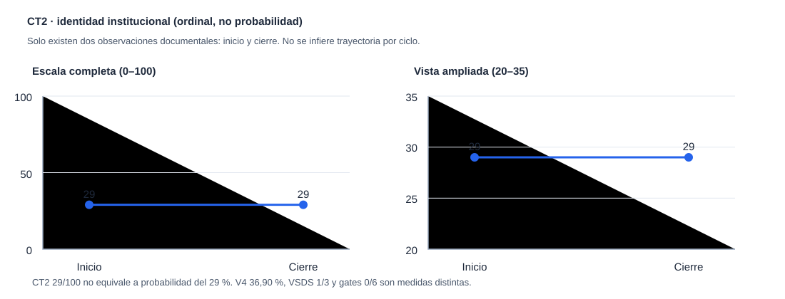

# Cierre verificable · Campaña PFL AB-H BRANCH20 · 28/10/2026

**Estado:** `CLOSED_19_VALID_1_INVALID_0_REMAINING`. Repositorio privado `GalexY3/Metodologia-AB`, rama canónica `main`. Campaña iniciada con autorización expresa de **20 intentos/ciclos AB-H en branching**, independientes de CONT80 y ChatRelay. El balance es **19 A–J documentados válidos, uno inválido (C01) y cero disponibles**. Un ciclo documental o técnico cuenta como trabajo AB-R/AB-P/AB-META en su alcance, **NO** como descubrimiento empírico, contraste causal ni validación global de producción.

## Evidencia por ciclo

| Ciclo | Modalidad | Resultado y límite |
|---|---|---|
| C01 | AB-R, **INVÁLIDO** | Resultado de fuentes escrito antes de consultas; errata e invalidación conservadas, nunca reintegrado como válido. |
| C02 | AB-R | Negativo documental: índices oficiales de BOCCL, sin originales recuperados ni primera hora de publicación. |
| C03 | AB-H | Solapamiento sintético de códigos de voto causaba `STRICT_REVERSAL` aparente; 7 controles rojos, después 14 PASS focalizados. Código corregido. |
| C04 | AB-P | Reglas sintéticas `Rule` mutables o inválidas; 6 rojos, después 8 PASS focalizados. Copias inmutables. |
| C05 | AB-META | Lectura directa de 39 deltas y verificación independiente de cadena/referencias documentales; no checker Python. |
| C06 | AB-P | Comparación crítica con PR #11: cinco blobs exactamente iguales, otras tres rutas conservan marcadores esenciales. No fusionar código antiguo en bloque. |
| C07 | AB-R | Separación de opción modal (pluralidad) frente a mayoría estricta sobre denominadores explícitos; controles Python aislados, no votos reales. |
| C08 | AB-P | Retirada de indicador falso de avance `3/5` de la portada; 6 controles estáticos. Browser/Node no ejecutados en la campaña. |
| C09 | AB-R | Tasa de eventos por oportunidad ≠ conteo futuro sin exposición futura; función separada, 7 controles numéricos aislados. No modelo político calibrado. |
| C10 | AB-H | Recuperación selectiva de módulo histórico `typed_refs.py` y sus 6 pruebas originales SHA-idénticas; no identidad personal automática. |
| C11 | AB-R | Rechazo justificado de `source_time.py` histórico como sustituto de `first_public_at`: cinco casos Python; día oficial no equivale a instante público probado. |
| C12 | AB-P | Recuperación del normalizador de fechas documentales del Congreso, 14 tests originales PASS con hashes exactos, sin inferir hora de publicación. |
| C13 | AB-P | Rechazo del `source_guard.py` antiguo: aceptar URL sintética con puerto `:0` demuestra control de origen más débil; cuatro pruebas antiguas PASS pero test adversarial negativo. |
| C14 | AB-P | Rechazo del `release_gate.py` antiguo: recibos de confianza fabricados por llamante permiten `release_allowed`/puntuación en función aislada; no es exploit demostrado del servidor actual. |
| C15 | AB-R | Recuperación de proyección documental histórica de diputados y 11 pruebas originales PASS con hashes exactos; sin originales nominales ni endpoint. |
| C16 | AB-R | Verificado en logs históricos reales del run GitHub 40344682502 que dos originales agregados habían sido cotejados (350 filas cada uno). No importar endpoint obsoleto, sin permisos de reutilización adjudicados. |
| C17 | AB-P | JSON con clave duplicada se resolvía por «última gana»; se añadió rechazo anidado, 2 FAIL antes y 14 PASS focalizados después; solo datos sintéticos. |
| C18 | AB-H | Interoperabilidad de módulos selectivamente recuperados, **35/35 pruebas focalizadas Python PASS** en paquete reconstruido. No suite completa. |
| C19 | AB-META | `batch_check` del Atlas admite cuatro timestamps sintéticos inválidos por validar solo cadena no vacía. Incidencia abierta, **no reparada**; reproducción del cuerpo de función original, no replay total. |
| C20 | AB-META | Auditoría nueva de 38 archivos prerregistro/resultado C01–C19, cronología de commits de cinco ciclos y 19 deltas 0036–0054: sin errores de número, padre o referencia en el alcance examinado. No certifica cada ejecución original. |

Cada ciclo tiene `CXX_PREREG.json` y `CXX_RESULT.json` en esta carpeta; C01 tiene además `C01_ERRATA.md`. El cierre C20 conserva **la invalidación**. Las ejecuciones documentales, las pruebas locales y los commits no deben confundirse con validación de fuentes públicas originales.

## Atlas y QA

- **Atlas antes de campaña:** 35 lotes, 201 runs, 44 complaints, 370 ops (datos documentales).
- **Atlas al cierre:** **55 lotes, 63 nodos, 81 aristas, 221 runs, 48 complaints, 396 operaciones** (recuentos **derivados**, no `atlas_delta.py check`).
- Cadena de lotes 0036–0054 inspeccionada por referencia GitHub: 19 `run.add`, 4 `complaint.add`, 2 `complaint.triage`, 25 operaciones, sin rupturas de padre; 0055 añade C20 con 1 `run.add`. El checker Python canónico de **55 lotes NO SE HA EJECUTADO**; SHA del estado canónico **DESCONOCIDO**.
- **T008 pendiente**: checkout completo `main` en Linux/POSIX, suite integral pytest y checker canónico Atlas 55. Los 89 PASS históricos CONT80 +14 subtests, así como los tests focalizados de esta campaña, no son sustituto. Los 57 FAIL Windows de T002 no se pueden dar por solucionados mediante extrapolación. Sin nueva ejecución costosa de Actions.
- **Incidencia abierta:** `PFL-BRANCH20-C19-ATLAS-UNVALIDATED-AT`, fecha `at` no validada como ISO-aware. Preparar reparación compatible con lotes legados **solo después** de comprobar replay; no reescribir lotes inmutables.

## Validez sociológica, CT2 y lanzabilidad

| Indicador | Inicio | Cierre | Interpretación |
|---|---:|---:|---|
| CT2 identidad | 29/100 | 29/100 | Escala **ordinal** de trayectoria científica; NO probabilidad de éxito |
| VSDS | 1/3 | 1/3 | Valor técnico-instrumental, sin beneficio sociológico verificado 2/3 |
| V4 contractual | 36,90 % | 36,90 % | Progreso relativo a hitos, no preparación para publicar |
| Nuevos hallazgos N1/N2/N3 | 0/0/0 | 0/0/0 | Ningún descubrimiento independiente nuevo atribuido |
| Gates críticos superados | 0/6 | 0/6 | Prohibido activar puntuación política real o publicación multiusuario |

**Gráfico CT2:** representa solo los dos hitos documentados, inicio y cierre, **sin inventar valores intermedios**. La escala completa y el zoom muestran 29→29; no debe interpolarse una serie de 20 observaciones.

## Decisión AB-DECIDE

1. **CERRAR** el presupuesto (19 válidos, un inválido, 0 restantes). No solicitar ni ejecutar más ciclos bajo esta autorización.
2. **MANTENER** `main` como rama operativa y los branches divergentes como archivos, seleccionando únicamente piezas que tengan evidencia y pruebas propias. Nunca fusionar Atlas de ramas paralelas en bloque.
3. **STOP_R5** para repetir regresiones sintéticas de la misma clase sin instrumentos nuevos. Las pruebas hechas no bastan para estimar prevalencias, efectos políticos, identidad jurídica, derechos o publicación temporal.
4. **POSPONER** T008 y la incidencia del timestamp del Atlas hasta que el usuario disponga de Codex/otro ejecutor con checkout Linux íntegro; no declararlas completas por la existencia de esta ficha.
5. **PRIORIDAD FUTURA:** datos oficiales originales accesibles y con derechos claros, estimandos longitudinales temporales verificados, controles de oportunidad/exposición, identidades y pertenencias históricas auditadas, evaluación del valor social independiente de la app fantasy.

## Solicitud de presupuesto nuevo (no concedido)

**SOLICITO BRANCHING AB-H DE 20 CICLOS NUEVOS**, como techo flexible, con prioridad en fuentes institucionales primarias, falsación de mecanismos longitudinales y arquitectura del observatorio, reservando un bloque para T008 cuando haya ejecutor disponible. No completar cuotas artificialmente; iniciar **solo tras autorización explícita posterior del usuario**.
