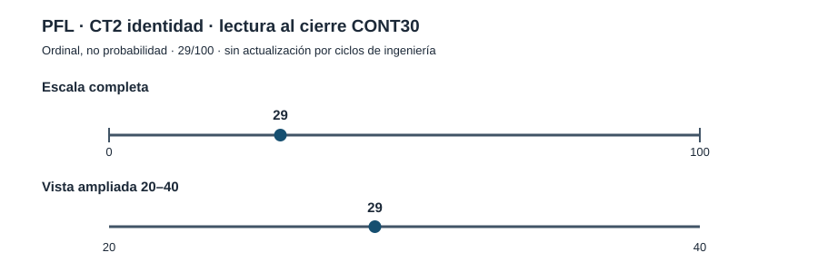

# Politics Fantasy League · AB-H CONT30 · cierre C21–C30

**Fecha:** 27-10-2026. **Rama:** `research/pfl-codex-contributions-20261027`. **Autorización:** «Sí, concedidos. Asegúrate de estar haciendo los ciclos completos y de forma correcta, y reportar avance», respuesta directa a la solicitud de **10 nuevos ciclos AB-H**. **Resultado:** C21–C30, **10/10 ciclos AB-P con registro A–J**, cero pendientes, **ningún descubrimiento científico nuevo**. [Ledger](CAMPAIGN_STATUS.json) · [Atlas batch 0025](../../ab_atlas/updates/0025-pfl-abh-cont30-c21-c30-20261027.json). Los informes individuales `C21_RESULT.json` … `C30_RESULT.json` contienen literalmente A, B, C, D, E, F, G, H, I y J; existen prerregistros anteriores a las ejecuciones.

**Este bloque obtuvo la primera ejecución nativa verificable de código exacto del GitHub privado en la continuidad reciente.** No se simuló un checkout completo: se reconstituyeron únicamente tres módulos Python fuente byte a byte, y se comparó `git hash-object` con sus blobs GitHub. El entorno no podía resolver `github.com` mediante `git`; la reconstrucción se efectuó usando GitHub conectado y copia fiel de archivos comprobada por SHA. No existen datos personales originales en las fixtures.

## Resumen A–J por ciclo (evidencia específica)

| Ciclo | Contraste efectuado | Resultado medido | Objeción y decisión |
|---|---|---|---|
| **C21 AB-P** | `private_audit_cli.py` SHA exacto, auditor agregado inyectado para cubrir decisiones de salida. | **10 pruebas nativas PASS**, `0.06 s`. [C21](C21_RESULT.json). | Dependencia `private_audit` sustituida explícitamente; no conclusión end-to-end. C22 prueba la dependencia real. |
| **C22 AB-P** | Tres módulos SHA exactos (`secure_store`, `private_audit`, CLI), archivos POSIX reales, 27 pruebas sintéticas. | Primera corrida **24 PASS/3 FAIL** por permisos predeterminados **0644** de fixtures creadas manualmente. Reparación del *test local*, no del producto: **27/27 PASS, 0.18 s**. [C22](C22_RESULT.json). | Negativos iniciales preservados; no ampliar al resto de la app. |
| **C23 AB-P** | `tests/test_private_audit_cli.py` del repositorio, hash verificado. | **8/8 PASS, 5.94 s**, en procesos CLI reales. [C23](C23_RESULT.json). | Sigue siendo una familia del repo, no pytest total. |
| **C24 AB-P** | Primer replay sin modificar `tests/test_private_audit.py` SHA exacto. | **21 PASS / 3 FAIL, 0.89 s**. Fallaron precisamente tests de claves duplicadas y NaN por permisos **0644** anteriores al parser. [C24](C24_RESULT.json). | **Resultado adversarial real sobre los tests**, no evidencia de fallo del parser. Se conservó salida original. |
| **C25 AB-P** | Prerregistro, tres `chmod(0o600)` exclusivamente sobre fixtures, sin tocar fuente ni aserciones JSON. | Test GitHub modificado [commit 316d6fc](https://github.com/GalexY3/Metodologia-AB/commit/316d6fc6894bc696990da82596f8d3bcb6ab96e7); blob local y remoto idéntico. **24/24 PASS, 0.70 s**. [C25](C25_RESULT.json). | Corrige el oráculo de test, **no** libera archivos privados ni eleva gates. |
| **C26 AB-P** | `tests/test_secure_store.py` original GitHub SHA exacto. | **22/22 PASS, 0.16 s**, incluyendo `O_NOFOLLOW`, directorios, conflictos de SHA y fragmentación. [C26](C26_RESULT.json). | POSIX local; no corte de luz. |
| **C27 AB-P** | Contraste con **8 procesos Python independientes × 40 filas, dos rondas**, sobre `fcntl.flock`, introduciendo dos `os.write` por registro. | **640/640 filas únicas**, 0 errores de proceso, 0 temporales, SHA correcto, semillas 701 y 702. [C27](C27_RESULT.json). | Cooperación entre escritores únicamente, sin adversario externo. |
| **C28 AB-P** | `SIGKILL` real contra subprocess dentro de `append_private_jsonl` (primera fila y tras una fila válida). | Dos procesos exit **-9**, línea no terminada. `audit_private_root` devuelve `INCOMPLETE_LEDGER_RECORD` y CLI exit **2** en ambos casos. [C28](C28_RESULT.json). | **Detecta**, no recupera, y no simula energía eléctrica. |
| **C29 AB-P** | `SIGKILL` dentro de `store_bytes` antes/después del hardlink SHA. | Prelink: 1 entrada temporal inesperada; postlink: 1 temporal y 1 objeto huérfano. CLI exit **2** en ambos. [C29](C29_RESULT.json). | Instrumentación inicial que modificaba `os.link` global fue **inválida** y se registró; repetición válida interrumpió `_verify_object` sin modificar `os.supports_dir_fd`. |
| **C30 AB-P** | Incorporación de cuatro tests POSIX de procesos/interrupciones `tests/test_private_store_process_boundaries.py`, originales en GitHub y misma copia local por SHA. | [Commit b4e4c46](https://github.com/GalexY3/Metodologia-AB/commit/b4e4c4691456b644a0e3fa3009cb5c9cc52ae033), **4/4 PASS en 4.13 s**. Reejecución conjunta **58/58 PASS en 10.48 s** de cuatro suites originales/versionadas. [C30](C30_RESULT.json). | Validación **parcial** del proyecto, no suite global ni certificación de durabilidad. |

## Reproducibilidad y archivos comprobados

**Fuentes exactas sin modificaciones**, `git hash-object` local igual al blob GitHub:

- `src/politics_fantasy/secure_store.py`: `4695c8d85924869212d916fa163a8f3548272ebc`
- `src/politics_fantasy/private_audit.py`: `18c2aea58e98c0aae059169ef70fa5fca77c0dcf`
- `src/politics_fantasy/private_audit_cli.py`: `923a1c479c3f970e1325beff36699a277bc3773c`

**Cuatro archivos de pruebas idénticos a la rama final:**

- `tests/test_private_audit_cli.py`: `20ab836b6cf37b1f5073455e10673acbaead9e13`, 8 pruebas.
- `tests/test_private_audit.py` tras C25: `7b9d89f94579e8be84833662df280847ea70d191`, 24 pruebas.
- `tests/test_secure_store.py`: `a63143acda49182fe8e83f30a5a46816e65bc42f`, 22 pruebas.
- `tests/test_private_store_process_boundaries.py` tras C30: `2a60cf0f61d3eb2b3f92987678f14064b3370653`, 4 pruebas.

Ejecución conjunta reproducible **en el subconjunto reconstruido**: `PYTHONPATH=src python -m pytest -q tests/test_private_audit_cli.py tests/test_private_audit.py tests/test_secure_store.py tests/test_private_store_process_boundaries.py` ⇒ **58 passed in 10.48 s**. Entorno: Python 3.13, pytest 9.0.2, Linux/POSIX. Los logs están en la carpeta de trabajo local `/mnt/data/pfl_cont30_native/`; el informe contiene recuentos y hashes, no originales privados.

## Auditoría adversarial y distinciones normativas

- **R1 estimando:** funcionalidad local de importación privada y auditoría, **no** puntuación de personas, licencias por conjunto, identidad política o predicción electoral.
- **R2 comparador:** los contrastes de procesos usan escritores no concurrentes/éxitos definidos frente a intervención; no se ha ejecutado comparación con otro sistema de persistencia. El test de C24 antes y después de corregir fixtures es un comparador concreto.
- **R3 multiplicidad:** 58 pruebas son casos de regresión parcialmente correlacionados, **no 58 réplicas científicas**. Hubo 3 fixtures inicialmente inválidas, corregidas y transparentadas; un instrumento de C29 inválido y reejecutado. Los 10 ciclos son de ingeniería AB-P, ninguno añade una clase científica de 1/3.
- **R4 mecanismo:** `fcntl.flock` comprobado entre procesos cooperantes, `O_NOFOLLOW`, `fsync`, revisión de objetos desde dirfd. No se declara tolerancia a crash eléctrico ni atomicidad del par objeto–manifiesto–review.
- **R5:** no repetir catálogos RPP/NO VOTAN sin originales o el mismo microtest por cuota; el bloqueo siguiente **sí cambia instrumento**: checkout completo de la rama actual y replay nativo de toda la aplicación.

## AB Atlas, indicadores y gráficas CT2

Lote append-only `0025-PFL-ABH-CONT30-C21-C30-20261027` sobre `0024`, **10 operaciones `run.add`**, sin modificar gates, relaciones, complaint o nodos. Total **derivado** de los estados y lotes anteriores: **25 lotes; 63 nodos, 81 relaciones, 149 runs, 44 complaints y 318 operaciones**. No se ha ejecutado el `atlas_delta.py check` **Python canónico de 25 lotes** ni obtenido su hash; los números son contabilidad documental de deltas.

**V4 36,90% · CT2 identidad 29/100 ordinal · VSDS 1/3 · N1/N2/N3 nuevos 0/0/0 · seis gates 0/6.** Ninguna mejora de código se ha contado como prueba de preparación pública, confianza estadística, base jurídica para perfilado ni validación independiente de originales.

La gráfica expone **un único punto de CT2 documentado**, con escala completa 0–100 y ampliada 20–40: no inventa una trayectoria ascendente a lo largo de C21–C30. Los DRIFT de esta campaña fueron instrumentales **D0–D1** respecto al producto; no nuevos dominios científicos D3–D5.

## Próxima tarea externa verificable

[Incidencia #17 de GitHub para Codex](https://github.com/GalexY3/Metodologia-AB/issues/17) registrada como solicitud, **no como ejecución**. Requiere checkout íntegro y SHA de HEAD de la rama `research/pfl-codex-contributions-20261027`; `python ab_atlas/atlas_delta.py check` sobre los **25 lotes originales** y sha canónico; `pytest` total del proyecto y suite JavaScript/Node; historial de versiones/comandos/exits; contrastes negativos de scripts de C21–C30; **sin GitHub Actions costosas, merge a main, ni exposición de originales privados**. Actualizar el alcance de la incidencia de 24 a 25 lotes si ejecuta Codex. No asumir que el ejecutor ya haya hecho nada.

**Autorización agotada: 10/10. SOLICITO BRANCHING 10 NUEVOS CICLOS AB-H**, priorizando ejecución integral, auditoría adversarial de fallos reales y fuentes institucionales originales solo cuando haya evidencia nueva.
